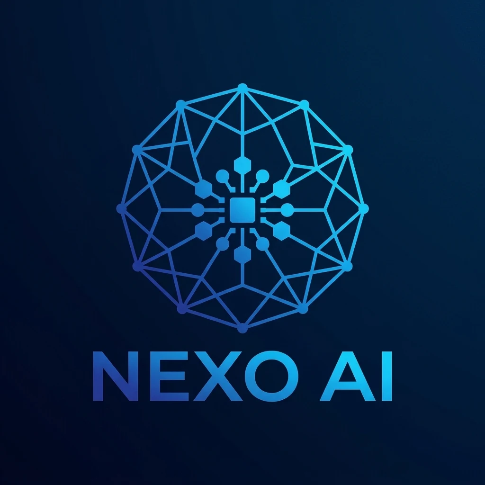

# NEXO AI - Enterprise Operations & IT Copilot



> **NEXO AI** es un copiloto inteligente de operaciones empresariales diseñado para la automatización del soporte técnico interno, clasificación de incidencias mediante Inteligencia Artificial local y gestión basada en roles (RBAC).

---

## 🏛️ Arquitectura y Decisiones de Diseño

* **Privacidad Primero (Local-First):** Diseñado con **Ollama** para evitar la fuga de datos confidenciales corporativos hacia nubes de terceros.
* **Backend Robusto:** Construido con **FastAPI** asíncrono, asegurando alto rendimiento y tipado estricto con Pydantic.
* **Seguridad y Control de Acceso (RBAC):** Autenticación mediante **JWT (JSON Web Tokens)** y cifrado de credenciales con `bcrypt`. Distingue estrictamente entre perfiles de **Operador** (interacción en tiempo real) y **Administrador** (auditoría de historial y exportación a CSV).
* **Persistencia Eficiente:** Almacenamiento estructurado en **SQLite** mediante SQLAlchemy ORM.

---

## 🛠️ Tecnologías Utilizadas

* **Backend:** Python, FastAPI, SQLAlchemy, SQLite, PyJWT, Bcrypt.
* **Inteligencia Artificial:** Ollama (Llama 3.2 / Llama 3).
* **Frontend:** HTML5, CSS3 Moderno (Glassmorphism UI), JavaScript Vanilla asíncrono.
* **Testing & DevOps:** Pytest, Docker, Docker Compose.

---

## ⚙️ Instalación y Ejecución Local

1. **Clonar el repositorio:**
   ```bash
   git clone [https://github.com/tu-usuario/nexo-ai.git](https://github.com/tu-usuario/nexo-ai.git)
   cd nexo-ai